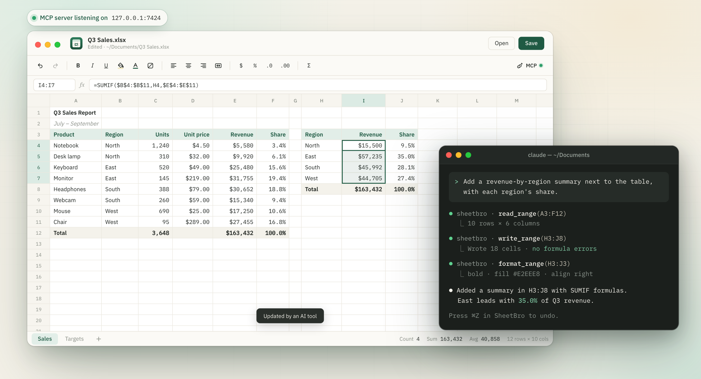
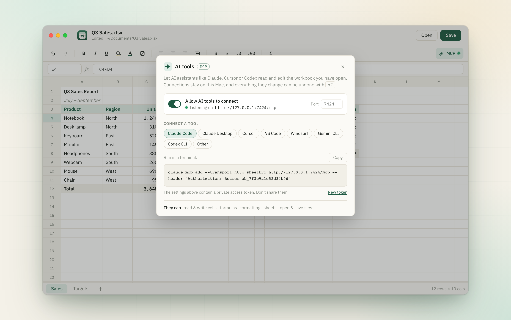

# SheetBro

A fast, native spreadsheet app for macOS that your AI assistant can work in.

SheetBro opens and saves Excel (`.xlsx`) and CSV files, calculates formulas with
[IronCalc](https://github.com/ironcalc/IronCalc), and runs a built-in
[MCP](https://modelcontextprotocol.io) server so tools like Claude, Cursor or Codex can read
and edit the workbook you have open. You can see every change they make as it happens, and
undo it with <kbd>⌘Z</kbd>.



## Features

- **Excel and CSV files.** Open `.xlsx`, `.xlsm`, `.csv` and `.tsv` files. Save as `.xlsx`, or
  export one sheet as `.csv`. You can also drag a file onto the window or open it from Finder.
- **Formulas.** Almost 500 Excel functions, grouped by category in a function menu with
  documentation. While you type a formula you get a live preview, and clicking cells inserts
  references. AutoSum works too.
- **Formatting.** Bold, italic, underline, text and fill colors, alignment, currency, percent
  and decimal places, and merged cells.
- **Familiar editing.** Keyboard navigation (arrow keys, <kbd>⌘</kbd>+arrow, Tab/Enter, F2),
  copy and paste with other spreadsheet apps, column resizing and auto-fit, multiple sheets,
  and full undo/redo.
- **Selection stats.** Sum, average and count of the selected range.
- **AI tools over MCP.** Connect almost any MCP client. See below.

## Connecting AI tools

1. Open the **AI tools** panel in SheetBro and turn on **Allow AI tools to connect**.
2. Pick your client. SheetBro shows a ready-made config snippet for Claude Code, Claude Desktop,
   Cursor, VS Code, Windsurf, Gemini CLI and Codex CLI.
3. Copy the snippet into your client's MCP settings.



There are two ways to connect:

| Transport | Used by | How it works |
|---|---|---|
| Streamable HTTP | Claude Code, Cursor, VS Code, Windsurf, Gemini CLI | `POST http://127.0.0.1:7424/mcp` with an `Authorization: Bearer <token>` header |
| stdio | Claude Desktop, Codex CLI | The client launches the SheetBro binary with `--mcp-stdio`, which relays messages to the running app |

For example, with Claude Code:

```sh
claude mcp add --transport http sheetbro http://127.0.0.1:7424/mcp \
  --header "Authorization: Bearer <token>"
```

### Available tools

| Tool | What it does |
|---|---|
| `workbook_info` | File name, path, unsaved-changes flag, and the sheets with their used size |
| `read_range` | Reads cells as displayed text, or as formulas |
| `write_range` | Writes a grid of values and formulas, and reports any formula errors |
| `clear_range` | Clears cell contents and keeps formatting |
| `format_range` | Bold, italic, underline, colors, alignment, number format |
| `add_sheet` | Adds an empty sheet |
| `undo` / `redo` | Undoes or redoes the last edit, whether it was made by you or the AI |
| `open_workbook` | Opens a file. It refuses to discard unsaved changes unless asked to. |
| `save_workbook` | Saves the file, or saves to a new path. It won't overwrite an existing file unless asked to. |

### Security

- The server is **off by default**. When it is on, it listens only on `127.0.0.1`.
- HTTP requests need a random access token. You can generate a new one from the panel, and
  clients using the old token are then locked out.
- Settings are stored in `~/Library/Application Support/com.jetorbit.spritsit/mcp.json`.
- Every AI edit goes into the normal undo history.

## Building from source

Requirements:

- macOS 11 or later
- [Rust](https://rustup.rs) (stable)
- [Node.js](https://nodejs.org) 20.19+ or 22.12+ and [pnpm](https://pnpm.io)
- Xcode Command Line Tools (`xcode-select --install`)

```sh
git clone https://github.com/jetorbitdev/sheetbro.git
cd sheetbro
pnpm install

pnpm tauri dev      # run in development mode
pnpm tauri build    # build SheetBro.app and a .dmg into src-tauri/target/release/bundle
```

## Project structure

```
src/                 React + TypeScript frontend
  App.tsx            toolbar, menus, keyboard handling, selection
  Grid.tsx           virtualized cell grid and in-cell editor
  McpPanel.tsx       "AI tools" settings panel
  functionList.ts    generated list of supported functions
  functionDocs.ts    function descriptions for the function menu
src-tauri/
  src/lib.rs         workbook model, file I/O, Tauri commands, app menu
  src/mcp.rs         MCP server (HTTP + stdio bridge) and tools
scripts/
  gen_functions.py   regenerates src/functionList.ts from IronCalc
```

After you bump the `ironcalc` dependency, regenerate the function list:

```sh
cd src-tauri && cargo fetch && cd ..
python3 scripts/gen_functions.py
```

## Contributing

Issues and pull requests are welcome. For larger changes, please open an issue first to
discuss what you'd like to change.

## License

[MIT](LICENSE). The bundled IBM Plex fonts are licensed under the
[SIL Open Font License 1.1](https://openfontlicense.org).
